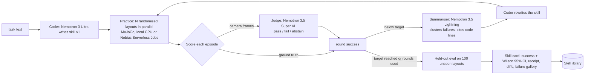

# Knack

**Type a task. Simulated robots practise it in parallel. Nemotron rewrites the robot's code after every failure, a vision model judges success from camera frames, and you get a verified, deployable skill. Zero demonstrations.**

[](LICENSE)


Built for the Nebius x NVIDIA Global AI Hackathon (Physical AI track). Runs on **NVIDIA Nemotron open models served by Nebius Token Factory**, with an optional **Nebius AI Cloud Serverless Jobs** backend for parallel practice.

> Status (23 Oct 2026): first live results are in (below). Every number comes from a file on the [`results` branch](https://github.com/su0as/knack/tree/results/results), written by the [`live` workflow](.github/workflows/live.yml) on a GitHub-hosted runner calling Nebius Token Factory. Nothing here is projected or estimated.

---

## The problem

Teaching a robot arm a new tabletop task today means one of two things: an engineer hand-codes and tunes it for days, or someone records 50 to 200 teleoperated demonstrations and trains a policy. Both are slow and both are out of reach for small labs, classrooms and people with a cheap open arm like the SO-101.

Knack takes the third route that NVIDIA GEAR's ASPIRE and Yilun Du's RAX opened up: **let a coding agent practise**. The agent writes a program, many simulated robots try it on randomised layouts, the failures are analysed, the program is rewritten, and the loop repeats until the skill is good. What comes out is plain Python that runs locally in milliseconds, inside a fixed safety layer, with no model in the control loop.

## What you see in 30 seconds

1. Pick a scene, type the task (or keep the default wording), press **PRACTISE**.
2. The **loop rail** (WRITE, PRACTISE, SCORE, ANALYSE, REWRITE, VERIFY) lights up the current step and names the model doing it. The **model chips** in the header show tokens and dollars per model so far.
3. A grid of robots practises in parallel. Each tile turns green or red; failed tiles show the error.
4. After each round the trace summariser explains the failures and the coder's diff appears.
5. When practice ends, the **skill card** shows held-out success on unseen layouts with a 95% confidence interval, a dollar receipt per model, every round's notes, failure analysis and code diff, and a failure gallery.

```
knack ui            # console at http://127.0.0.1:8765
```

## Which model does what

| Role | Model (all NVIDIA open models via Nebius Token Factory) | Why this model |
|---|---|---|
| Coder: writes and rewrites `skill.py` | `nvidia/Nemotron-3-Ultra-550b-a55b` ($1.00 / $3.00 per M tokens). Cheaper option: `nvidia/nemotron-3-super-120b-a12b` ($0.30 / $0.90) | Strongest open reasoning model for code; Super tests whether a 10x cheaper model is enough |
| Trace summariser | `nvidia/Nemotron-3_5-Lightning` ($0.06 / $0.24) | Reads the long, token-heavy episode traces so the expensive coder only reads a short analysis |
| Success judge (vision reward) | `nvidia/Nemotron-3.5-Super-VL` ($0.30 / $0.90) | Looks at start/end camera frames and says pass/fail with a confidence; abstains when unsure |
| Baseline coder (comparison only) | `deepseek-ai/DeepSeek-V4.1-Flash` (also on Token Factory) | Non-NVIDIA reference point used by RAX |

Prices were read from the Token Factory catalogue on 23 Oct 2026. Every call is logged with its token counts and cost in `runs/<run>/ledger.jsonl`, and summed per role on the skill card.

**Nebius services used**
- **Token Factory**: every model call above (OpenAI-compatible API; Knack falls back to the per-model regional endpoint if the global one returns 404).
- **AI Cloud Serverless Jobs** (optional, `--backend nebius`): each practice round runs as one CPU job (`cpu-d3`, e.g. `16vcpu-64gb`) that installs Knack in a stock `python:3.12-slim` image and runs all episodes of the round in parallel; results land in an Object Storage bucket. Compute time is priced onto the receipt.

## How it works



- **Robot API** (`knack/robot.py`): `observe, get_pose, move_to, move_by, grasp, release, holding, home, wait`. The same API is exposed as **MCP tools** (`knack mcp`) and implemented for a real SO-101 (`knack/real`, experimental).
- **Safety layer** (`knack/safety.py`): deterministic Python under every AI-written skill. Workspace box, joint limits, Cartesian and joint speed caps, elbow clearance, gripper-on-table force limit. Small violations are clamped and logged; large ones halt the skill with an exception that skill code cannot catch (bare `except:` is rejected statically).
- **Sandbox** (`knack/sandbox.py`): AST allowlist (math, numpy, itertools, functools, collections), restricted builtins, one OS process per episode with a wall-clock kill.
- **Scenes** (`knack/tasks.py`): `lift`, `place`, `push` (a puck too wide to grasp), `stack`, `tray`, `sort`. A 5-DoF arm with SO-101 proportions and a parallel gripper, built from primitives in MuJoCo so it runs on any CPU with no downloads. Layouts, masses, friction and grip force are randomised per episode; observations carry about 2 mm of noise.
- **Rewards**: `gt` (simulator check), `vlm` (vision judge only; the coder never sees ground truth), `self` (the skill grades itself, included to measure how badly that goes).
- **Zero demonstrations**: the coder sees the task text, the API doc and an example observation. The hand-written reference skills in `knack/oracles.py` exist only to prove each scene is solvable in CI; a test asserts that no prompt contains them.

## Quickstart

Python 3.10+. Works natively on Windows, macOS and Linux (no WSL needed).

```powershell
# Windows PowerShell (example: everything on D:)
git clone https://github.com/su0as/knack D:\dev\knack
powershell -ExecutionPolicy Bypass -File D:\dev\knack\scripts\setup_windows.ps1
#   makes .venv (uv if present, else py -3.12), installs knack[dev], creates .env from .env.example,
#   keeps caches on D:, then runs the free checks. Put your Token Factory key in .env as NEBIUS_API_KEY.
. D:\dev\knack\scripts\env_windows.ps1    # each new session
```

```bash
# macOS / Linux
git clone https://github.com/su0as/knack && cd knack
python -m venv .venv && source .venv/bin/activate
pip install -e ".[dev]"
cp .env.example .env      # set NEBIUS_API_KEY
```

Then, cheapest first:

```bash
knack check                       # MuJoCo, rendering, key present (no calls)
knack oracle                      # reference fixtures solve every scene (no LLM, free)
knack learn lift --mock           # full pipeline with a canned coder (no tokens)
knack models --remote             # list models your key can see (free)
knack learn lift --coder super --budget 0.30      # first real run, hard-capped at $0.30
knack pilot                       # day-1 gate: Super vs Ultra on lift/place/push, capped at $0.90
knack ui                          # console
```

Every command that calls a model takes `--budget` (USD) and stops cleanly when it is reached.

## Results

All runs on 23 Oct 2026, zero demonstrations, 8 parallel practice episodes per round, held-out success on **50 unseen layouts** with a Wilson 95% interval. Cost is the exact Token Factory bill for the whole run (every model call), from `ledger.jsonl`.

**1. Nemotron 3 Ultra programs all six scenes for under 7 cents each.** Standard perception (about 2 mm pose noise):

| scene | Nemotron 3 Nano (3B active) | Nemotron 3 Super | Nemotron 3 Ultra | DeepSeek V4.1 Flash (baseline) |
|---|---|---|---|---|
| lift | | 100% · $0.011 | 100% · $0.006 | |
| place in circle | | 100% · $0.004 | 100% · $0.005 | |
| push puck | | 80% · $0.005 | 90% · $0.065 | |
| stack | 64% · $0.006 | 72% · $0.028 | 100% · $0.004 | 100% · $0.005 |
| into the tray | 100% · $0.001 | 64% · $0.013 | 100% · $0.005 | 100% · $0.009 |
| sort by colour | 0% · $0.006 | 100% · $0.003 | 100% · $0.006 | 100% · $0.003 |

Sources: `results/20261023-090645-pilot`, `results/20261023-093859-scoreboard-hard`. For context only (different benchmark, LIBERO-Pro): ASPIRE's published chart puts open-weight coding agents at about $40 to $55 per task. The honest reading is that Knack's scenes with near-perfect perception are easy for a strong coder: Ultra and DeepSeek solved them on the first try, and practice mattered only for the smaller models.

**2. With camera-grade perception, first attempts fail and practice is what gets the skill working.** `--realism real` adds about 8 mm of pose noise per reading, 0.08 rad of yaw noise and wider mass, friction and grip randomisation (what a cheap arm with an overhead camera sees):

| run | practice rounds (success on 8 layouts) | held-out (50 layouts) | cost |
|---|---|---|---|
| Super, push | 0% → 12% → 12% → 12% → 0% → 50% | **82%** (CI 69% to 90%) | $0.028 |
| Super, stack | 12% → 75% → 50% → 50% → 75% → 50% | **62%** (CI 48% to 74%) | $0.045 |
| Ultra, stack | 50% → 88% → 62% → 62% → 62% → 50% | **64%** (CI 50% to 76%) | $0.108 |
| Ultra, push | 0% → 12% → 0% → 0% → 12% → 12% | 10% (CI 4% to 21%) | $0.100 |

For comparison, the hand-written reference fixtures under the same noise score 57% on stack and 87% on push (30 layouts each). Source: `results/20261023-100205-real-stack-push`. Ultra on push is a failure we publish on purpose: its rewrites kept adding clearance logic that drove the arm into its workspace limits.

**3. What practice adds, measured directly.** `knack exp gain` re-runs each run's *first* version (written before any feedback) on the exact 50 held-out layouts the practised version was scored on. Where the best version was round 1 the two numbers match exactly, which checks that the comparison is like for like.

| run | first version | after practice | gain |
|---|---|---|---|
| Super, push, camera-grade | 3/50 (6%) | 41/50 (82%), round 6 | **+76 pts** |
| Super, lift | 0/50 (0%) | 50/50 (100%), round 3 | **+100 pts** |
| Super, tray | 23/50 (46%) | 32/50 (64%), round 4 | +18 pts |
| Super, stack, camera-grade | 29/50 (58%) | 31/50 (62%), round 5 | +4 pts (within noise) |
| Ultra, stack, camera-grade | 32/50 (64%) | 32/50 (64%), round 2 | 0 |
| Ultra, push, camera-grade | 7/50 (14%) | 5/50 (10%), round 6 | -4 pts |
| 16 other runs | solved in round 1 | | 0 |

Source: `results/20261023-101415-practice-gain/gain-*/practice_gain.md`. Two lessons went straight back into the code: an 8-episode practice score is too noisy to pick the best version (Ultra's "88%" round equalled its first version on held-out), so Knack now re-checks the top versions on 16 fresh layouts before the final evaluation; and a rewrite that scores worse is discarded (see 4).

**4. Four things the live runs changed in the code** (each in the commit history):
- Nemotron 3.5 Lightning with thinking on spent its whole 4000-token budget reasoning and returned the unfinished thought as the "analysis". The summariser now runs with `enable_thinking: false` (about 460 output tokens, about 4 s).
- Ultra once edited its own broken rewrite three times in a row (88% → 0% → 0% → 0%). A rewrite that scores worse is now discarded and the next rewrite starts from the best version, with the harmful diff shown to the coder.
- The overhead judge camera was washed out; the floor and headlight were toned down so the vision judge can see positions.
- Practice scores on 8 layouts picked the wrong "best" version; the top versions are now re-checked on 16 fresh layouts (simulator only, no tokens).

**5. A vision reward works when the outcome is visible, and gets gamed when it is not.** Same coder (Super), three reward sources, held-out scored by ground truth (`results/*-ablation`):

| reward used during practice | stack | lift ("at least 5 cm above the table") |
|---|---|---|
| simulator ground truth | 50/50 | 36/50 |
| **Nemotron 3.5 Super VL judging 4 camera frames** | **49/50** | **0/50** |
| the skill's own `return True` | 50/50 | 50/50 |

On stack, the judge agreed with ground truth on all 52 practice and held-out episodes it scored, so practice with no simulator signal at all produced a 98% skill. On lift it said "success, 0.95" on every episode where the cube was held a few millimetres short of 5 cm, which no camera at 320x240 can see, so the coder stopped at round 1 with a skill that never meets the spec. The lift skill trained on the judge also returned `True` on all 50 held-out episodes that ground truth failed: an agent grading itself, or graded by a model that cannot see the criterion, will report success it did not achieve. This is the case for keeping a measurable check wherever one exists, and for writing task specs a camera can verify.

Still to run: Kimi K3 as a second reference coder, and a Serverless Jobs run. Commands:

| Finding | Command | Output |
|---|---|---|
| Ground truth vs vision judge vs self-report as the reward | `knack exp ablation` | `ablation.json` |
| Vision-judge accuracy and abstention vs ground truth | `knack exp judge runs/` | `judge_eval.json`, `judge_coverage.png` |
| What practice adds | `knack exp gain "runs/**/*-gt*"` | `practice_gain.md` |
| First try vs practised, side by side | `knack replay <run_dir> --compare --n 6` | GIF + PNG |

## Real arm (experimental)

`python -m knack.real run runs/<run>/best_skill.py --task lift --port COM5` runs a learned skill on an SO-101 through LeRobot, with object poses from an overhead camera and the same IK and safety layer as the simulator. Try `--dry-run` first. It has **not** been tested on hardware yet; see the checklist in `knack/real/so101.py`.

## Limitations

See [docs/LIMITATIONS.md](docs/LIMITATIONS.md). The short version: simplified arm model, perfect-ish perception in simulation, a guardrail sandbox rather than a security boundary, untested real-arm and Nebius Jobs paths, and a vision judge that can be wrong (which is why it abstains and why we measure it).

## Inspirations and credit

- **ASPIRE** (NVIDIA GEAR, Apache-2.0, github.com/NVlabs/ASPIRE): coding agents that discover robot skills; its success-vs-API-cost chart has no Nemotron point, which is the gap Knack fills.
- **RAX** (Yilun Du et al., github.com/robot-agent-exploration/rax): scale exploration, not demonstrations.

Knack is an independent implementation; no code was copied from either project.

## Repository layout

```
knack/agent.py        practice loop            knack/judge.py      vision judge (abstains)
knack/robot.py        robot API + API doc      knack/safety.py     deterministic limits layer
knack/sim.py          MuJoCo scene + env       knack/kinematics.py analytic IK (shared with real arm)
knack/tasks.py        scenes + GT checks       knack/sandbox.py    static checks + restricted exec
knack/runner.py       parallel local runner    knack/nebius.py     Serverless Jobs runner
knack/llm.py          Token Factory + ledger   knack/card.py       skill card (json/md/html)
knack/experiments.py  pilot/scoreboard/...     knack/ui/           console
knack/mcp_server.py   robot tools over MCP     knack/real/         SO-101 backend (experimental)
```

## Feedback on Nebius and NVIDIA tools

Required by the hackathon and kept in [docs/FEEDBACK.md](docs/FEEDBACK.md).

Other docs: [STATUS](docs/STATUS.md) (what is tested, what is not), [LIMITATIONS](docs/LIMITATIONS.md), [DEVPOST draft](docs/DEVPOST.md), [video script](docs/VIDEO.md).

## License

MIT, see [LICENSE](LICENSE).
