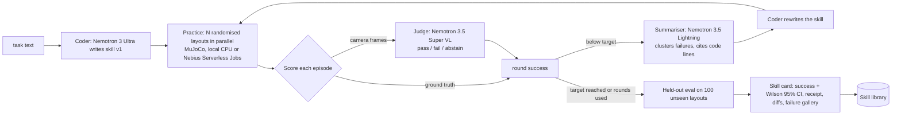

# Knack

**Type a task. Simulated robots practise it in parallel. Nemotron rewrites the robot's code after every failure, a vision model judges success from camera frames, and you get a verified, deployable skill. Zero demonstrations.**

[](LICENSE)


Built for the Nebius x NVIDIA Global AI Hackathon (Physical AI track). Runs on **NVIDIA Nemotron open models served by Nebius Token Factory**, with an optional **Nebius AI Cloud Serverless Jobs** backend for parallel practice.

> Status (23 Oct 2026): code complete for the core loop, tests run in CI with an offline mock coder. **No live Nemotron results are published yet**; every number in the Results section will come from files in this repo once the experiments are run. Nothing below is a projected or invented number.

---

## The problem

Teaching a robot arm a new tabletop task today means one of two things: an engineer hand-codes and tunes it for days, or someone records 50 to 200 teleoperated demonstrations and trains a policy. Both are slow and both are out of reach for small labs, classrooms and people with a cheap open arm like the SO-101.

Knack takes the third route that NVIDIA GEAR's ASPIRE and Yilun Du's RAX opened up: **let a coding agent practise**. The agent writes a program, many simulated robots try it on randomised layouts, the failures are analysed, the program is rewritten, and the loop repeats until the skill is good. What comes out is plain Python that runs locally in milliseconds, inside a fixed safety layer, with no model in the control loop.

## What you see in 30 seconds

1. Pick a scene, type the task (or keep the default wording), press **PRACTISE**.
2. A grid of robots practises in parallel. Each tile turns green or red. The **model chips** show which model is doing what and what it has cost so far.
3. After each round the trace summariser explains the failures and the coder's diff appears.
4. When practice ends, the **skill card** shows held-out success on unseen layouts with a 95% confidence interval, a dollar receipt per model, and a failure gallery.

```
knack ui            # console at http://127.0.0.1:8765
```

## Which model does what

| Role | Model (all NVIDIA open models via Nebius Token Factory) | Why this model |
|---|---|---|
| Coder: writes and rewrites `skill.py` | `nvidia/Nemotron-3-Ultra-550b-a55b` ($1.00 / $3.00 per M tokens). Cheaper option: `nvidia/nemotron-3-super-120b-a12b` ($0.30 / $0.90) | Strongest open reasoning model for code; Super tests whether a 10x cheaper model is enough |
| Trace summariser | `nvidia/Nemotron-3_5-Lightning` ($0.06 / $0.24) | Reads the long, token-heavy episode traces so the expensive coder only reads a short analysis |
| Success judge (vision reward) | `nvidia/Nemotron-3.5-Super-VL` ($0.30 / $0.90) | Looks at start/end camera frames and says pass/fail with a confidence; abstains when unsure |
| Baseline coder (comparison only) | `deepseek-ai/DeepSeek-V4.1-Flash` (also on Token Factory) | Non-NVIDIA reference point used by RAX |

Prices were read from the Token Factory catalogue on 23 Oct 2026. Every call is logged with its token counts and cost in `runs/<run>/ledger.jsonl`, and summed per role on the skill card.

**Nebius services used**
- **Token Factory**: every model call above (OpenAI-compatible API; Knack falls back to the per-model regional endpoint if the global one returns 404).
- **AI Cloud Serverless Jobs** (optional, `--backend nebius`): each practice round runs as one CPU job (`cpu-d3`, e.g. `16vcpu-64gb`) that installs Knack in a stock `python:3.12-slim` image and runs all episodes of the round in parallel; results land in an Object Storage bucket. Compute time is priced onto the receipt.

## How it works



- **Robot API** (`knack/robot.py`): `observe, get_pose, move_to, move_by, grasp, release, holding, home, wait`. The same API is exposed as **MCP tools** (`knack mcp`) and implemented for a real SO-101 (`knack/real`, experimental).
- **Safety layer** (`knack/safety.py`): deterministic Python under every AI-written skill. Workspace box, joint limits, Cartesian and joint speed caps, elbow clearance, gripper-on-table force limit. Small violations are clamped and logged; large ones halt the skill with an exception that skill code cannot catch (bare `except:` is rejected statically).
- **Sandbox** (`knack/sandbox.py`): AST allowlist (math, numpy, itertools, functools, collections), restricted builtins, one OS process per episode with a wall-clock kill.
- **Scenes** (`knack/tasks.py`): `lift`, `place`, `push` (a puck too wide to grasp), `stack`, `tray`, `sort`. A 5-DoF arm with SO-101 proportions and a parallel gripper, built from primitives in MuJoCo so it runs on any CPU with no downloads. Layouts, masses, friction and grip force are randomised per episode; observations carry about 2 mm of noise.
- **Rewards**: `gt` (simulator check), `vlm` (vision judge only; the coder never sees ground truth), `self` (the skill grades itself, included to measure how badly that goes).
- **Zero demonstrations**: the coder sees the task text, the API doc and an example observation. The hand-written reference skills in `knack/oracles.py` exist only to prove each scene is solvable in CI; a test asserts that no prompt contains them.

## Quickstart

Python 3.10+. Works natively on Windows, macOS and Linux (no WSL needed).

```powershell
# Windows PowerShell (example: everything on D:)
git clone https://github.com/su0as/knack D:\dev\knack
cd D:\dev\knack
uv venv --python 3.12 .venv ; .\.venv\Scripts\Activate.ps1   # or: python -m venv .venv
uv pip install -e ".[dev]"                                     # or: pip install -e ".[dev]"
copy .env.example .env    # then put your Token Factory key in NEBIUS_API_KEY
```

```bash
# macOS / Linux
git clone https://github.com/su0as/knack && cd knack
python -m venv .venv && source .venv/bin/activate
pip install -e ".[dev]"
cp .env.example .env      # set NEBIUS_API_KEY
```

Then, cheapest first:

```bash
knack check                       # MuJoCo, rendering, key present (no calls)
knack oracle                      # reference fixtures solve every scene (no LLM, free)
knack learn lift --mock           # full pipeline with a canned coder (no tokens)
knack models --remote             # list models your key can see (free)
knack learn lift --coder super --budget 0.30      # first real run, hard-capped at $0.30
knack pilot                       # day-1 gate: Super vs Ultra on lift/place/push, capped at $0.90
knack ui                          # console
```

Every command that calls a model takes `--budget` (USD) and stops cleanly when it is reached.

## Results

Not run yet. The experiments are scripted so each number traces to a JSON file:

| Finding | Command | Output |
|---|---|---|
| Success vs practice rounds | `knack pilot`, `knack exp scoreboard` | `runs/*/pilot.json`, per-round success in each `card.json` |
| Cheapest Nemotron that can program a robot ($ per skill) | `knack exp scoreboard` | `scoreboard_summary.json`, `docs/figures/scoreboard.png` |
| Ground truth vs vision judge vs self-report as the reward | `knack exp ablation` | `ablation_summary.json` |
| Vision-judge accuracy and abstention vs ground truth | `knack exp judge runs/` | `judge_eval.json`, `docs/figures/judge_coverage.png` |

The scoreboard chart also shows the open-weight points from ASPIRE's published success-vs-API-cost chart as hollow markers. They were measured on LIBERO-Pro, a different benchmark, so they are context, not a head-to-head comparison.

## Real arm (experimental)

`python -m knack.real run runs/<run>/best_skill.py --task lift --port COM5` runs a learned skill on an SO-101 through LeRobot, with object poses from an overhead camera and the same IK and safety layer as the simulator. Try `--dry-run` first. It has **not** been tested on hardware yet; see the checklist in `knack/real/so101.py`.

## Limitations

See [docs/LIMITATIONS.md](docs/LIMITATIONS.md). The short version: simplified arm model, perfect-ish perception in simulation, a guardrail sandbox rather than a security boundary, untested real-arm and Nebius Jobs paths, and a vision judge that can be wrong (which is why it abstains and why we measure it).

## Inspirations and credit

- **ASPIRE** (NVIDIA GEAR, Apache-2.0, github.com/NVlabs/ASPIRE): coding agents that discover robot skills; its success-vs-API-cost chart has no Nemotron point, which is the gap Knack fills.
- **RAX** (Yilun Du et al., github.com/robot-agent-exploration/rax): scale exploration, not demonstrations.

Knack is an independent implementation; no code was copied from either project.

## Repository layout

```
knack/agent.py        practice loop            knack/judge.py      vision judge (abstains)
knack/robot.py        robot API + API doc      knack/safety.py     deterministic limits layer
knack/sim.py          MuJoCo scene + env       knack/kinematics.py analytic IK (shared with real arm)
knack/tasks.py        scenes + GT checks       knack/sandbox.py    static checks + restricted exec
knack/runner.py       parallel local runner    knack/nebius.py     Serverless Jobs runner
knack/llm.py          Token Factory + ledger   knack/card.py       skill card (json/md/html)
knack/experiments.py  pilot/scoreboard/...     knack/ui/           console
knack/mcp_server.py   robot tools over MCP     knack/real/         SO-101 backend (experimental)
```

## Feedback on Nebius and NVIDIA tools

Required by the hackathon and kept in [docs/FEEDBACK.md](docs/FEEDBACK.md).

## License

MIT, see [LICENSE](LICENSE).
