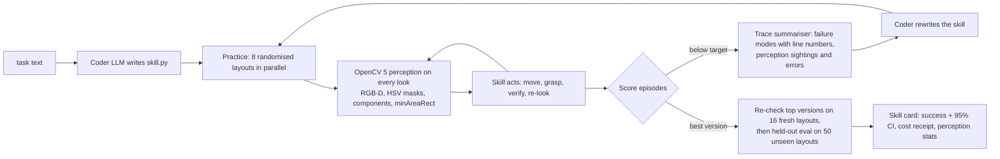
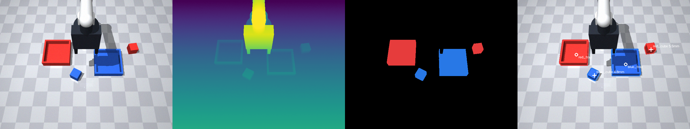

# Knack: robots that learn a skill by practising, seeing the scene through OpenCV 5

Technical report for the OpenCV AI Competition 2026 (powered by AWS). Team: Suhas Suren (NTU Singapore, MSc Robotics).
Code: https://github.com/su0as/knack. Live demo on AWS: http://13.212.24.5/. Every number below is read from a file in the repository (`results` branch);
the source is named next to each table.

## 1. Problem and users

Teaching a robot arm a new tabletop task today means either an engineer hand-coding and tuning it for days, or someone
recording 50 to 200 teleoperated demonstrations to train a policy. Both are out of reach for small labs, classrooms and
makers with a cheap open arm. Knack takes a third route: a coding agent writes the robot's program, simulated robots
practise it on many randomised layouts, the failures are analysed, the program is rewritten, and the best version is
verified on unseen layouts. Zero demonstrations. The output is a plain Python skill that runs without any model in the
control loop, inside a fixed safety layer.

Users: robotics students and small teams who need a working pick, place, push, stack or sort skill on a low-cost arm,
and need to know how well it works before trusting it.

## 2. Where OpenCV 5 does the work

In vision mode (`--realism vision`) the robot never reads object poses from the simulator. Every `observe()` and
`get_pose()` call goes through an OpenCV 5 perception pipeline on rendered RGB-D frames (`knack/vision.py`):

1. Capture RGB and depth from an overhead camera (front camera as backup), with a sensor model: depth noise growing with
   distance squared, 1 mm depth quantisation, RGB noise, and a per-episode extrinsic calibration error that the pipeline
   does not know about.
2. `cv2.cvtColor` to HSV, `cv2.inRange` colour masks for the scene palette, `cv2.morphologyEx` opening.
3. `cv2.connectedComponentsWithStats` to separate blobs; candidates are taken largest first and rejected if their
   footprint is larger than the object could be (this is how same-coloured tray walls are not mistaken for the cube).
4. Back-projection of every mask pixel to 3D with the pinhole intrinsics and camera pose; points on same-coloured
   fixtures are removed geometrically.
5. Top-face selection by height, then `cv2.minAreaRect` in the table plane for centre and yaw.
6. Static fixtures (target circles, trays) are mapped once per episode; a tray's centre comes from its wall-top ring.
7. Objects that neither camera can see (typically under the gripper) are missing from the observation and `get_pose()`
   raises `LookupError`.

The pipeline's output is the only thing the robot's program knows about the world, so OpenCV's detections decide every
grasp point, approach yaw and verification step.

## 3. The agentic loop (perception, decision, action)

OpenCV output changes later actions at two levels:
- **Inside an episode:** the skill observes, acts, re-observes and branches on what it sees (for example, if the cube is
  not visible because the gripper hides it, the skill moves away and looks again; if a placed cube is not where it should
  be, it retries).
- **Across practice rounds:** each episode's perception record (sightings, misses, median error) is fed back to the
  coder with the failure analysis, so the next version of the program changes how and when it looks.

## 4. AWS deployment

- One Arm (Graviton) instance runs both the console and the practice episodes; the OpenCV 5 and MuJoCo work runs there.
- Secrets live in SSM Parameter Store as SecureString and are read once at boot; nothing secret is in the repository,
  the image or the user data. No SSH port: administration is through Session Manager.
- Public console: anyone can browse every run, frame by frame. Starting a new run spends model credits, so it needs a
  passcode (given in the testing instructions), is capped at $0.10, and only one run can start every two minutes.
- Cost guardrails: Free account plan (credits only), AWS Budgets alerts at $1, $5 and $10, one region, no autoscaling.
- Reproduce: `deploy/aws/README.md` and `deploy/aws/user-data.sh`.

## 5. Evaluation

### 5.1 Perception accuracy (OpenCV 5 vs simulator ground truth)

30 random layouts per scene (`results/*-perception-bench-sensor`, `knack exp perception`). Static = the first look,
nothing occluded. In use = every look while the hand-written reference skill runs, so the gripper occludes objects and
cubes are held, stacked and dropped into trays. Sensor model: depth noise 4 mm x z^2, 1 mm depth quantisation, RGB noise
sigma 4, extrinsic calibration error 3 mm / 0.4 deg drawn once per episode.

| scene | static detection | median error | p90 error | max error | yaw error | fixtures | ms per look | in-use detection | in-use median error |
|---|---|---|---|---|---|---|---|---|---|
| lift | 100% | 4.29 mm | 7.35 mm | 9.17 mm | 0.26 deg | n/a | 174.1 | 100% of 120 | 4.05 mm |
| place | 100% | 4.25 mm | 7.05 mm | 8.86 mm | 0.34 deg | 3.15 mm | 190.0 | 100% of 120 | 3.6 mm |
| push | 100% | 4.3 mm | 8.62 mm | 9.41 mm | n/a (puck) | 3.75 mm | 178.3 | 97% of 145 | 3.56 mm |
| stack | 100% | 4.29 mm | 7.35 mm | 9.17 mm | 0.26 deg | n/a | 179.7 | 100% of 120 | 4.05 mm |
| tray | 100% | 4.29 mm | 7.28 mm | 8.94 mm | 0.48 deg | 3.1 mm | 177.1 | 100% of 120 | 3.71 mm |
| sort | 100% | 4.51 mm | 7.4 mm | 9.89 mm | 0.37 deg | 3.38 mm | 186.5 | 99% of 238 | 3.92 mm |

Reading it: about 4 mm median and under 10 mm worst-case position error, with the calibration error the main
contributor (with a perfect, noise-free render the same pipeline has a median error under 0.3 mm, which is why the sensor model is on by default).
Detection drops below 100% only in use, when the gripper hides the puck (push) or a cube (sort); those misses are exactly
the cases the skill has to handle by looking again. One look costs about 180 ms on a GitHub Actions x86 runner
(two RGB-D renders plus OpenCV).

### 5.2 Skills learned with OpenCV perception

Three Nemotron coder models, four scenes, perception entirely through the OpenCV 5 pipeline with the sensor model above
(`results/*-vision-scoreboard-sensor`). Up to 6 practice rounds of 8 layouts, then a held-out evaluation on 50 unseen
layouts with the 95% Wilson interval. Cost is the total Token Factory bill for the whole run.

| coder | lift | push | stack | sort | total cost |
|---|---|---|---|---|---|
| Nemotron 3.5 Super | 42/50 (71% to 92%) | 48/50 (87% to 99%) | 50/50 (93% to 100%) | 49/50 (90% to 100%) | $0.038 |
| Nemotron 3 Ultra | 50/50 (93% to 100%) | 28/50 (42% to 69%) | 50/50 (93% to 100%) | 49/50 (90% to 100%) | $0.135 |
| Nemotron 3 Nano 30B | 0/50 | 0/50 | 49/50 (90% to 100%) | 0/50 | $0.036 |

Perception during those 600 held-out episodes (from each run's `eval.json`): median position error 3.8 to 5.5 mm per
run; detection 99% to 100% of looks for every run except one (Nano sort, 72%: its skill kept asking for cubes while the
gripper was on top of them, 467 misses in 1,682 looks, and the skill never succeeded).

### 5.3 What practice adds

Practice-round success (8 layouts per round, practice reward = ground truth) for the runs that did not solve the task
on the first try:

| run | round 1 | round 2 | round 3 | round 4 | round 5 | round 6 | held-out |
|---|---|---|---|---|---|---|---|
| Super, lift | 0/8 | 0/8 | 4/8 | 8/8 | | | 42/50 |
| Ultra, push | 0/8 | 0/8 | 1/8 | 5/8 | 5/8 | 4/8 | 28/50 |
| Nano, stack | 0/8 | 2/8 | 0/8 | 8/8 | | | 49/50 |

The Super lift run shows how camera output reshapes the program. Version 1 already looked again when the cube
was hidden, but it threw away the camera's height estimate and grasped at a hard-coded 15 mm. Its round 2 analysis,
which receives each episode's camera record ("N/M object sightings, median error X mm") alongside the failure, reported
lifts ending millimetres short and failed grasps. The final version grasps at the camera-measured cube centre
(x, y and z), re-observes after every move to check the gripper reached the commanded height, nudges upward when the
lift ends low, and retries the grasp from a fresh observation. Diff: `round_1/skill.py` vs `best_skill.py` in the run
folder.

## 6. Failure cases and limitations

- Simulated cameras: even with the sensor model, rendered images are cleaner than a real camera (no motion blur, no
  specular highlights, no lighting changes). Real-camera validation on an SO-101 arm is the next step; the overhead
  pipeline for the real arm (`knack/real/vision.py`) uses the same OpenCV steps with a homography.
- Colour-based segmentation assumes a known palette. Unknown objects would need a learned detector (OpenCV 5's DNN
  engine is the natural next step).
- Occlusion: when the gripper hides an object, the object is missing; skills must handle it. Some first-version skills
  do not, which is one of the failure modes practice fixes.
- The coder model can write skills that regress; Knack keeps the best version and re-checks it on fresh layouts.
- Vision-model success judges (tested separately) can be fooled when the success criterion is not visible (for example
  "at least 5 cm above the table"); the ground-truth check is kept wherever one exists.

## 7. Responsible use

- Zero demonstrations and no personal data: the system never records people.
- The learned skill runs inside a deterministic safety layer (workspace box, joint and speed limits, table-force limit)
  that AI-written code cannot catch or override. A real arm still needs a hardware emergency stop.
- AI-written code runs in a guardrail sandbox (AST allowlist, restricted builtins, one process per episode, wall-clock
  kill); it is not a security boundary, so the public demo never runs code from visitors.
- Costs are bounded at every level: per-run budget caps, a passcode for the public demo, and AWS budget alerts.
